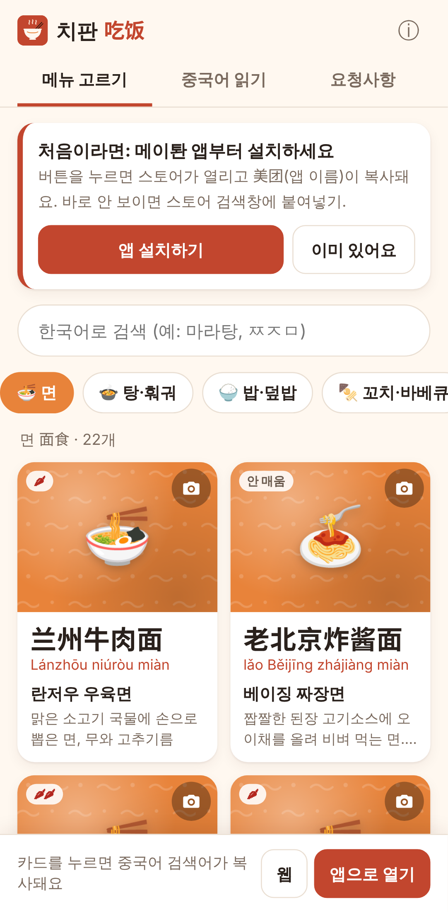

# 치판 吃饭

중국 배달앱(메이퇀 등)을 쓰는 한국인을 위한 폰 웹앱.
**카테고리와 그림으로 메뉴를 고르면 중국어 검색어를 복사**하고, 배달앱(지금은 웹페이지)을 열어 준다.
사용자는 앱 검색창에 붙여넣기만 하면 된다.

> 치판은 메이퇀 등 배달앱과 관계없는 개인 실험 도구다. 검색어만 만들어 줄 뿐, 배달앱 화면·데이터에 접근하지 않는다.



## 실험 목적

타오바오 Search Translator(영어 검색어 → 중국어 검색)처럼, 중국어를 못 읽는 사람이
**"메뉴 이름을 몰라서 검색을 못 하는"** 문제를 검색어 복사만으로 풀 수 있는지 확인한다.

- 확인할 것: 카드 → 복사 → 앱 열기 → 붙여넣기 흐름이 실제 폰에서 불편 없이 되는가
- 확인할 것: 사전의 중국어 표기로 검색했을 때 원하는 가게·메뉴가 실제로 나오는가
- 확인할 것: 중국 안(VPN 없이)에서 github.io로 열리고, 한 번 연 뒤 오프라인에서도 쓸 수 있는가

## 첫 버전 범위

| 기능 | 내용 |
|---|---|
| 앱 설치 안내 | 첫 화면 위 카드: **[앱 설치하기]** → 스토어 열기 + `美团` 복사(스토어 검색창에 붙여넣기용). **[이미 있어요]**로 숨김. 정보(ⓘ)에도 설치 버튼 |
| 메뉴 고르기 | 카테고리 10개 탭 → 카드 그리드. 카드에 중국어(크게)·병음·한국어 이름·한 줄 설명·맵기 |
| 검색어 복사 | 카드를 누르면 중국어 검색어 자동 복사 + “복사됨: 麻辣烫” 토스트. 하단 바에 마지막 검색어 표시 |
| 앱 열기 | 하단 **[앱으로 열기]** / **[웹]** 두 버튼, 사용자가 고른다. 누를 때만 연다. 앱은 폰 종류를 자동 인식해 시도하고 안 열리면 웹으로(아래 참고) |
| 한국어 검색 | 이름·별칭 부분 일치, 초성(`ㅁㄹㅌ`, `ㅉㅈㅁ`), 입력 중인 글자(`말` → 마라탕), 중국어·병음(`mala`)도 됨 |
| 중국어 읽기 | 메이퇀에서 복사한 메뉴·옵션 글을 붙여넣으면 아는 단어마다 한국어 뜻을 달아 줌(가장 긴 단어부터 맞춤, 메뉴 이름은 눌러서 상세). 옵션·맛·음료·재료·주문·배달·가게 단어장 472개, 한국어로도 찾기 |
| 요청사항 문구 | 35개 문구를 골라 중국어 주문 메모(`少辣，不要香菜，不需要餐具…`)로 복사. 서로 겹치는 것(맵기, 얼음 등)은 하나만 |
| 내 사진 | 카드의 📷 → 상세 화면에서 사진 찍기/앨범에서 고르기. **이 기기 IndexedDB에만** 저장(긴 변 720px JPEG로 줄여서) |
| 최근 | 복사한 메뉴가 ‘최근’ 탭에 쌓임(localStorage) |
| 오프라인 | 서비스워커가 모든 파일을 캐시. 홈 화면에 추가 가능(PWA) |
| 인앱 브라우저 | 카카오톡·위챗 등 앱 안 브라우저면 “외부 브라우저로 열기” 안내 + 주소 복사 버튼 |

### 지키는 원칙 (lab 공통 원칙)

- 폰(안드로이드) 우선, 서버 없음, 저장은 기기 안에서만(localStorage / IndexedDB)
- 다른 서비스의 코드·문장·그림·데이터를 쓰지 않음. 설명 문구는 직접 썼고, 그림은 이모지 + 직접 그린 SVG(아이콘, 무늬)
- 웹에서 가져온 사진(위키미디어 포함) 없음
- 구글 폰트·외부 CDN·구글 API 없음. 모든 파일 자체 포함 (`tests/check-data.js`가 외부 주소를 검사)
- 메이퇀 페이지는 건드리지 않음: 프록시·iframe·비공식 API·스크래핑·차단 우회 없음. 서비스워커도 다른 출처 요청은 건드리지 않음
- 상표: 앱 이름·아이콘에 메이퇀 이름/로고/색을 쓰지 않음. “메이퇀에서 열기” 같은 설명 문구만 사용

## 앱 열기 방식과 확인 상태

앱 여는 주소는 **`js/config.js` 한 곳**에만 있다.

1. 카드를 누르면 검색어가 클립보드에 복사된다. (검색어를 앱에 직접 넘기는 딥링크 형식은 공개돼 있지 않아서 클립보드가 기본)
2. 하단 바에서 사용자가 고른다.
   - **[웹]**: H5 `https://h5.waimai.meituan.com/waimai/mindex/home` 를 새 탭으로 연다.
   - **[앱으로 열기]**: 폰 종류를 User-Agent로 자동 인식한다.
     안드로이드는 `intent://<path>#Intent;scheme=<scheme>;package=<package>;S.browser_fallback_url=<H5>;end`,
     iOS는 URL 스킴을 시도하고 `fallbackMs`(1.6초) 안에 페이지가 숨겨지지 않으면 H5로 넘어간다.
     PC나 앱 안 브라우저(카톡·위챗 등)에서는 이 버튼을 숨긴다.
   - 웹 페이지는 앱이 **설치돼 있는지 알 수 없다.** 그래서 자동으로 고르지 않고 두 버튼을 둔다.
   - `appOpen.enabled: false`로 두면 [앱으로 열기]를 숨긴다(웹만).
3. 사용자가 앱 검색창을 길게 눌러 붙여넣기.

페이지가 열리자마자 앱으로 넘기는 동작은 없다(브라우저가 막거나 확인창을 띄우므로). 모든 이동은 사용자 탭에서만.

### 확인된 값

| 항목 | 현재 값 | 상태 | 확인 날짜 / 기기 |
|---|---|---|---|
| H5 주소 | `https://h5.waimai.meituan.com/waimai/mindex/home` | 이 클라우드 환경에서 접속만 확인 (해외 IP라 가게 목록은 안 뜸) | 2026-10 |
| 안드로이드 패키지명 | `com.sankuai.meituan` | **확인됨** (설치·실행) | 2026-10-28 / 사용자 안드로이드 폰 |
| 안드로이드 intent scheme / path | `imeituan` / (빈칸) | **확인됨** ([앱으로 열기] → 앱 실행) | 2026-10-28 / 사용자 안드로이드 폰 |
| 검색어 넘기기 (안드로이드) | `imeituan://www.meituan.com/search?q={검색어}` (커뮤니티 URL 스킴 목록의 형식) | **확인됨** — lab.html 6번으로 검색 결과가 뜸. (처음 시험 땐 첫 화면만: 새로고침으로 복사 검색어가 사라졌던 탓으로 보임, 저장하도록 고침) | 2026-10-28 / 사용자 안드로이드 폰 |
| 검색어 넘기기 (iOS) | 같은 형식 | **미확인** | — |
| iOS URL 스킴 | `imeituan://` | **미확인 (추정)** | — |
| 설치: 안드로이드 스토어 | `market://details?id=com.sankuai.meituan` → 1.6초 안에 안 열리면 Google Play 웹 | **미확인** (패키지명 추정) | — |
| 설치: iOS App Store | `https://apps.apple.com/cn/app/id423084029` | **미확인** (앱 ID 추정, 중국 지역 Apple ID 필요할 수 있음) | — |

설치 링크가 틀려도 `美团`이 복사돼 있으니 스토어 검색창에 붙여넣으면 된다. Google Play는 중국 안에서 안 열리고, 중국 폰(샤오미·화웨이 등)은 `market://`을 자기 스토어로 연다.

**2026-10-28 실기기 확인 (안드로이드):** [앱 설치하기] → 설치됨, [앱으로 열기] → 메이퇀 앱 실행됨. 앱 첫 화면만 열 때는 검색어가 안 들어감.
공개된 URL 스킴 모음에 나온 후보를 `lab.html`로 하나씩 시험한 결과, 메이퇀 앱 `search?q=` 형식만 검색 결과를 열었다
(`meituanwaimai://…/search?query=`, `query=`, `keyword=`, `mtwm://`는 안 됨). [앱으로 열기]는 마지막으로 복사한 검색어를 이 형식으로 넘긴다.
안 되더라도 앱은 열리고 검색어는 클립보드에 있으므로 붙여넣기로 이어진다. (메이퇀 페이지나 앱 코드는 분석하지 않음)

**검색 링크 시험 페이지:** `lab.html` (https://lesumein.github.io/chifan/lab.html). 공개 URL 스킴 모음에 나온 후보
(`meituanwaimai://waimai.meituan.com/search?query=` 등)를 폰에서 한 번씩 눌러 보는 페이지. 되는 형식이 나오면 `js/config.js`에 반영한다.

실제 폰에서 확인되면 `js/config.js` 값을 고치고 `enabled: true`로 바꾼 뒤, 이 표에 날짜와 기기를 적는다.
(메이퇀 페이지나 앱 코드를 분석해서 알아내지 않는다. 폰에서 직접 확인한다.)

## 사전 데이터

- `data/categories.json` — 카테고리 10개 (id, 한국어, 중국어, 이모지, 색)
- `data/foods.json` — 음식 **190개**
- `data/requests.json` — 요청사항 **35개** (그룹 7개)
- `data/glossary.json` — 화면 단어장 **472개** (옵션·맛·음료·재료·주문·배달 상태·가게·음식 종류·앱 화면 공통). 직접 정리한 뜻풀이, 기계 번역 아님

`foods.json` 항목:

```json
{"id": "malatang", "cat": "soup", "ko": "마라탕", "aka": ["마라탄"],
 "zh": "麻辣烫", "py": "málàtàng", "desc": "한 줄 설명", "spicy": 2, "emoji": "🍲",
 "q": "(선택) 복사할 검색어가 zh와 다를 때", "check": true, "img": true}
```

- `spicy`: 0 안 매움 ~ 3 아주 매움
- `check: true`: 중국어 표기 **검증 필요** (카드에 ‘확인 중’ 표시)
- `img: true`: `img/<id>.jpg`가 있을 때만 (직접 찍은 사진 자리, `img/README.md` 참고)
- 항목을 늘린 뒤 `node tests/check-data.js`로 검사 (id 중복, 빠진 칸, zh 중복, 외부 주소 등)

### 검증 필요 목록

중국어 메뉴 이름은 중국 배달앱에서 흔히 보이는 표기를 기준으로 했지만, 아래는 특히 확신이 없다.
대부분 ‘중국 속 한식’인데, 가게마다 표기가 제각각이다. 실제 검색 결과를 보고 고칠 것.

| id | 한국어 | 지금 표기 |
|---|---|---|
| `laoya-tang` | 오리탕 | 老鸭汤 |
| `bento-kuaican` | 중국식 도시락 | 快餐便当 |
| `jirou-juan` | 브리또·랩 | 鸡肉卷 |
| `chaomamian` | 짬뽕 | 韩式海鲜面 (炒码面·辣海鲜面도 있음) |
| `haixian-jian` | 해물파전 | 海鲜饼 |
| `chunchuan-ji` | 춘천 닭갈비 | 春川辣炒鸡排 |
| `nen-doufu-tang` | 순두부찌개 | 嫩豆腐汤 |
| `paigu-tang` | 갈비탕 | 牛排骨汤 |
| `hanshi-tangcurou` | 탕수육 (한국식) | 韩式糖醋肉 |
| `lamian-hanshi` | 라면 (한국 라면) | 韩国拉面 |
| `yubing` | 어묵 (한국식) | 韩式鱼饼 |

`check`가 없는 항목도 병음·설명은 사람이 한 번 더 읽어 보는 게 좋다.

## 안드로이드 앱: 한국어 덧그리기 + 떠다니는 버튼 (실험)

웹앱은 메이퇀 화면 안에서는 아무것도 못 한다(글자 복사도 막혀 있음). 그래서 다른 앱 **위에** 한국어를 그려 주는 안드로이드 앱을 `android/`에 따로 만들었다.
lab 원칙 중 "웹앱 우선"에서는 벗어나지만, 나머지(안드로이드 폰 우선·서버 없음·기기 저장·메이퇀 안 건드림)는 그대로다.

**방식: 화면 캡처 + 폰 안 OCR.** 처음(0.1)에는 접근성 서비스로 글자를 읽었는데, 스토어 밖에서 받은 접근성 앱은 Google Play 프로텍트가 설치 자체를 막았다
("기기 보호를 위해 앱 차단됨", 무시하고 설치 버튼 없음 — 2026-10-29 실기기). 그래서 0.2부터 접근성을 완전히 빼고,
사용자가 허용한 화면 캡처(MediaProjection)를 폰 안 OCR(ML Kit 중국어 인식, 모델 내장)로 읽는다. 덕분에 메이퇀뿐 아니라 **어떤 앱이든** 한자가 보이면 동작한다.

**설치** (스토어 밖 앱이라 "출처를 알 수 없는 앱" 허용은 필요)
1. https://lesumein.github.io/chifan/apk/chifan-0.6-debug.apk 받기 (약 34MB, 웹앱 ⓘ 정보 화면에도 링크 있음) → 설치.
2. 치판 앱 열고 **[1. 다른 앱 위에 표시 허용]** → 치판 켜기.
3. **[2. 덧그리기 시작]** → 폰이 화면 캡처를 물으면 **전체 화면**으로 허용. 상태바에 캡처 중 표시와 치판 알림이 뜬다.
4. **[번역 모델 받기]** (약 60MB). 사전에 없는 말을 폰 안에서 번역하려면 필요하다. **한국에서 미리** 받을 것 — 중국에서는 구글 서버가 막혀 못 받는다. 받은 뒤엔 오프라인으로 돈다. 와이파이면 서비스가 시작될 때 조용히 받아 두기도 한다.
5. **[3. 메이퇀 열기]** → 오른쪽에 치판 버튼. 끝나면 알림의 **[중지]**.

**하는 것**
- 0.6초에 한 번, 화면이 바뀌었을 때만 캡처해 OCR → 줄마다 라벨. **빨강** = 직접 만든 사전(단어장 472 + 요청사항 35), **갈색** = 메뉴 이름(190), **파랑** = 폰 안 기계 번역(ML Kit, 중→영→한을 거쳐 품질은 보통). 사전이 먼저, 사전에 통째로 없는 줄만 번역.
- 번역은 같은 줄을 한 번만 하고 기억한다(800줄). 번역이 꺼져 있거나 모델이 없으면 줄 안에서 찾은 사전 단어를 이어 붙인다.
- 오른쪽의 **떠다니는 치판 버튼**: 메뉴 고르기(검색어 복사)·요청사항(메모 복사)·단어장. 위아래로 끌어 옮김. 창이 열려 있는 동안은 캡처를 쉰다.
- 라벨은 창 안 스위치나 설정 화면에서 끌 수 있다.
- 창의 **'읽은 글자'** 탭: 직전 화면에서 OCR이 읽은 줄과 붙인 뜻('—'는 사전에 없음). [전부 복사]해서 보내면 사전에 넣는다.
- 라벨은 글자 오른쪽 → 아래 → 위 순서로, 다른 글자를 가리지 않는 자리에 놓는다. 자기가 그린 라벨 자리를 읽은 줄은 버린다(0.3에서 라벨이 깜빡이던 원인).
- 라벨 규칙: 줄 전체 일치 > 단어 일치 > 줄 안에서 찾은 말 이어 붙이기. 이어 붙일 땐 한 글자 매칭(甜·冰·热…)은 버리고, 찾은 말이 한자의 절반을 못 덮으면 안 붙인다.

**안 하는 것 (설계로 막아 둠)**
- 다른 앱 화면을 누르거나 입력·스크롤하지 않는다. 접근성 권한을 쓰지 않으므로 할 수도 없다.
- 읽은 화면·글자를 기기 밖으로 보내지 않는다. 글자 인식도 번역도 폰 안에서 돈다. 인터넷 권한은 0.5부터 있지만 **번역 모델을 내려받는 데만** 쓴다 — 코드에 화면 내용을 보내는 곳이 없고, 열린 소스라 확인할 수 있다.
  (0.2~0.4는 인터넷 권한이 아예 없었다. 번역을 기본으로 넣기로 하면서 되돌렸다. 중국 번역 서비스(바이두 등)는 화면 글자를 서버로 보내야 해서 쓰지 않는다.)
- 캡처한 화면을 저장하지 않는다. 글자를 읽은 뒤 바로 버린다.
- 메이퇀 앱·서버에 접근하지 않는다.

**빌드:** JDK 17+, Android SDK(platform 35, build-tools 35). `android/local.properties`에 `sdk.dir=...` 넣고
`cd android && ./gradlew assembleDebug` → `app/build/outputs/apk/debug/app-debug.apk`.
외부 라이브러리는 ML Kit 둘: OCR(`text-recognition-chinese`, 모델 내장)과 번역(`translate`, 모델은 내려받음). arm64 폰만 지원(용량 때문, 2017년 이후 폰은 다 arm64).
사전은 `app/build.gradle.kts`에서 레포의 `data/`를 assets로 바로 쓴다.
디버그 서명이라 다른 PC에서 빌드한 APK로 덮어 설치하려면 먼저 지워야 한다. 정식 서명은 다음 단계.

**2026-10-29 실기기 확인 (안드로이드, 0.2):** 메이퇀 美食 목록 화면에서 OCR 덧그리기 동작, 라벨 위치 맞음. 사전에 가게 종류·앱 화면 단어가 없어 빈 곳이 많았고 한 글자 매칭이 엉뚱한 라벨(甜→단, 冰→차갑게)을 만들어 0.3에서 단어장 250개 추가 + 매칭 규칙 수정.

**아직 모르는 것 (실기기 확인 필요)**
- 가게 메뉴·옵션 화면(배달 주문 흐름)에서 OCR 정확도.
- 배터리·발열: 화면이 바뀔 때만 돌리지만 스크롤 중에는 계속 돈다.
- 메이퇀이 캡처를 막는 화면(결제 등)이 있는지 — 그 화면은 검게 잡혀 라벨이 안 붙는다.

**왜 '앱 안에서 바로 주문'은 안 하나:** 메이퇀에 소비자용 주문 API가 없다. 가능한 길(비공식 API 흉내, 메이퇀 웹에 끼워 넣기)은 모두 처음에 뺀 것들이다.

## 파일 구조

```
index.html              화면 (빌드 없음)
css/style.css           스타일 (시스템 글꼴만)
js/config.js            앱 여는 주소 (여기 한 곳만)
js/open.js              앱/H5 열기, 인앱 브라우저 감지
js/hangul.js            초성·부분 일치 검색
js/photos.js            내 사진 IndexedDB 저장
js/app.js               화면 로직
data/*.json             사전
img/                    직접 찍은 사진 자리 (img/<id>.jpg)
icons/                  직접 그린 아이콘·무늬 SVG + PNG
sw.js                   오프라인 캐시 (파일을 바꾸면 VERSION 올리기)
manifest.webmanifest    홈 화면 추가
tests/                  데이터 검사, 폰 화면 테스트, 아이콘 생성
android/                안드로이드 덧그리기 앱 (Kotlin + ML Kit OCR)
apk/                    빌드한 설치 파일
screenshots/            테스트가 만든 스크린샷
```

## 로컬 실행·테스트

```sh
python3 -m http.server 8000          # http://localhost:8000
node tests/check-data.js             # 사전·외부 주소 검사
node tests/screens.js                # Playwright: Pixel 7 / iPhone 13 화면 테스트 → screenshots/
node tests/make-icons.js             # icons/*.svg → PNG
```

`tests/screens.js`는 복사(클립보드 값), 토스트, 로드 시 자동 이동 없음, [열기] 버튼이 H5만 여는지,
한국어/초성/병음/중국어 검색, 사진 저장 후 새로고침 유지, 요청사항 메모 조합·복사, 오프라인 새로고침,
카카오톡 인앱 안내를 확인한다. 테스트 중 외부 접속은 모두 막는다.

## 배포 (GitHub Pages)

1. GitHub 레포 → **Settings → Pages**
2. **Build and deployment → Source: Deploy from a branch**
3. **Branch: `main` / `/ (root)`** → Save
4. 1~2분 뒤 `https://lesumein.github.io/chifan/` 에서 열림 (빌드 단계 없음, `.nojekyll` 포함)

모든 경로가 상대경로라 `/chifan/` 하위 경로에서도 그대로 동작한다. HTTPS라서 클립보드·서비스워커도 동작한다.

**주의: github.io는 중국 본토에서 느리거나 불안정할 수 있다.** 그래서
- 처음 한 번 열 때 서비스워커가 앱 파일 전체(약 200KB)을 캐시하고, 이후엔 캐시를 먼저 보여 준다(오프라인 가능).
- 가능하면 중국에 들어가기 전에 미리 열어 **홈 화면에 추가**해 두기.
- 중국에서 계속 안 열리면 다른 정적 호스팅(중국 접속이 되는 곳)을 다음 단계에서 검토.

## 다음 할 일

- [ ] 실제 폰(안드로이드 / 아이폰)에서 메이퇀 앱 패키지명·스킴·스토어 링크 확인 → `js/config.js` 반영, 위 표에 날짜 기록
- [ ] 중국 현지에서 github.io 접속 속도·오프라인 동작 확인
- [ ] ‘검증 필요’ 11개 항목을 실제 배달앱 검색 결과로 확인·수정, 나머지 표기도 샘플 검증
- [ ] 안드로이드 앱 실기기 확인: 번역 모델 받기, 번역 라벨 품질, 배터리, 버튼 창 키보드
- [ ] 다른 중국 앱용 단어 묶음(공통 UI 단어부터) — 이제 어느 앱이든 덧그리기가 되므로
- [ ] 정식 서명 키로 빌드, 버전 올리기
- [ ] 실제 메이퇀 옵션 화면에서 자주 보이는데 단어장에 없는 말 모아서 추가
- [ ] 직접 찍은 사진을 `img/<id>.jpg`로 추가
- [ ] 검색어 후보 여러 개(예: 짬뽕 → 韩式海鲜面 / 炒码面)를 카드에서 고를 수 있게 할지 검토
- [ ] 사용자가 직접 메뉴를 추가하는 기능(기기 저장) 검토
- [ ] 메이퇀 앱의 영어 모드 지원 여부 확인 (출처끼리 엇갈림)
